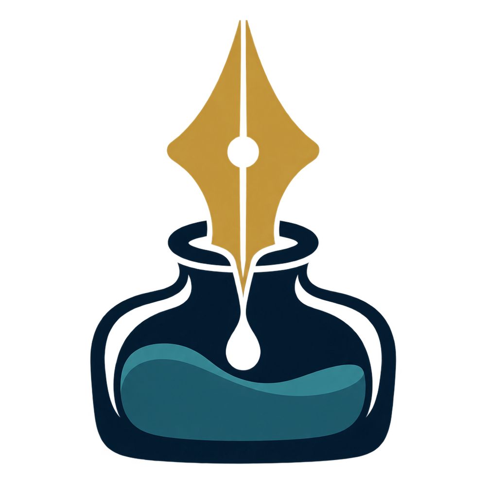
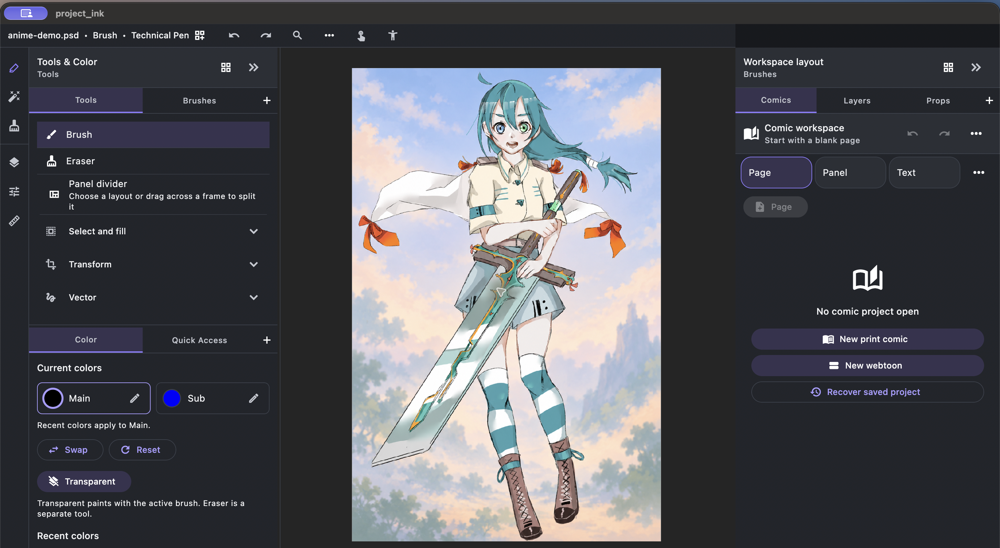
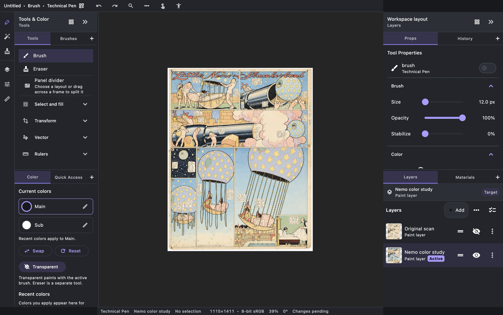

<p align="center">
  
</p>

<h1 align="center">Project Ink</h1>

<p align="center">
  <strong>Make art. Keep it yours.</strong><br>
  An open-source, mobile-friendly illustration and comic studio for touch,<br>
  stylus, and desktop.<br>
  Built with Rust. Shaped with Flutter. Local-first by design.
</p>

<p align="center">
  <a href="LICENSE"></a>
  
  
  
</p>

<p align="center">
  <a href="#try-it">Build from source</a> ·
  <a href="#where-ink-is-now">Alpha status</a> ·
  <a href="CONTRIBUTING.md">Contribute</a>
</p>

Project Ink is an illustration and comic studio built around the act of
drawing: responsive brushes, editable paths, a useful layer stack, and pages
that can grow into a comic. It runs locally, keeps work in a portable project,
and puts the canvas at the center of the experience.

## Made for illustration

- **Sketch, ink, and paint.** Use raster brush families with pressure-aware
  size, opacity, and flow, editable response curves, and stroke stabilization.
- **Shape and refine paths.** Draw editable Bézier paths, adjust anchors and
  handles, transform selections, and use guides, symmetry, or repeat tools to
  build a composition.
- **Keep artwork organized.** Work across paint and vector layers, groups,
  masks, clipping, and layer state controls. Undo and redo stay part of the
  drawing workflow.
- **Move from illustration to comics.** Build multi-page projects with panels
  and editable dialogue in the same studio. Comic workflows are experimental;
  see the current [alpha status](#where-ink-is-now) and export notes before
  relying on them.
- **Keep projects close.** Save portable `.inkproj` files and use local
  recovery. There is no required account, advertising, cloud sync, or network
  service.

The interface adapts from touch and stylus layouts to desktop workspaces, while
Rust remains authoritative for document state, pixels, layers, history,
persistence, and export. Flutter owns presentation, accessibility, and input.

Project Ink was underway before ArtCraft, PhotoCraft, and VectorCraft. As the
backend evolved, I chose to reuse selected crates from those projects where
they fit, because the Rust backend and application stack are similar. Ink keeps
its own illustration-first direction and document workflows.

## The visual direction

Ink is for making and refining illustrations and pages. Its workspace gives
brushes, paths, layers, and the canvas the leading role. Editing photographs
and preparing production-print files are outside the current scope. The app is
experimental, so the screenshots and feature notes should show real, current
workflows and name their limits clearly.

## Artwork in the editor

An anime background study, imported as a flattened raster canvas and shown in
Ink’s desktop workspace:

<p align="center">
  
</p>

The *Little Nemo* color study is shown below in Ink’s layer workflow. The
visible color-study layer sits above the untouched public-domain scan, which is
preserved as a hidden raster layer. The color pass was created outside Ink and
imported as an editable layer; this screenshot documents layer organization,
not in-app coloring.

<p align="center">
  
</p>

The artwork files and their sources are listed in the
[artwork references and credits](assets/readme/ARTWORK-CREDITS.md). They remain
local to this repository, so the README does not depend on remote image hosts
or test golden paths.

## Where Ink is now

Project Ink is **experimental** and changing quickly. iOS/iPadOS, Android,
macOS, Windows, and Linux are development targets—not promises of stable,
release-supported downloads. Platform support is earned separately through
install, input, file, recovery, and export checks.

For current candidates and release gates, see the
[alpha checklist](specifications/alpha-release-checklist.md),
[candidate verification notes](specifications/alpha-candidate-verification.md),
and [release readiness](specifications/release-readiness.md). The
[first-release scope](specifications/first-release-scope.md) describes the
intended workflows and non-goals.

## Try it

You’ll need the pinned Flutter 3.47.5 toolchain and a Rust toolchain. To run the
macOS app locally:

```sh
cd app
flutter pub get
flutter run -d macos
```

For platform setup, Rust bridge details, and validation commands, start with
the [app development guide](app/README.md). More architecture and file-format
notes live in [`specifications/`](specifications/). Engine ownership, CPU/GPU
reference checks, cache lifecycle, and sparse-history measurements are
described in the [engine guardrails](specifications/engine-design-guardrails.md).

## Open source, open canvas

Project Ink is licensed under the [Mozilla Public License 2.0](LICENSE).
Contributions are welcome—start with [CONTRIBUTING.md](CONTRIBUTING.md). Found
a security issue? Follow [SECURITY.md](SECURITY.md). Some bundled assets have
separate terms; check their accompanying notices before reuse.

<p align="center"><em>Your next sketch could help shape what comes next.</em></p>
